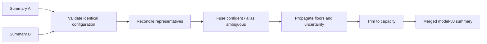

# Cardinex

**Cardinex is a bounded-memory semantic streaming data structure for compact, approximate aggregation over embedding streams.** It receives embeddings from an external model and retains a bounded semantic summary: representatives, approximate count/sum/mean intervals, item-ID exemplars, and uncertainty diagnostics.

The project investigates how geometric identity can participate directly in data-structure operations: semantic frequency aggregation, heavy-hitter discovery, distributed merging, and, eventually, distribution comparison. It is authored by Dip Chakraborty and released under the MIT License.

> **Research status:** this repository contains a working Go semantic sketch (model v0), C ABI, SDK bindings, HTTP/MCP service, conformance fixtures, tests, and synthetic experiment utilities. Its broader research architecture is only partly implemented. In particular, this repository does **not** implement a separate greedy-leader/Space-Saving engine, a Wasserstein-1 `diff()`, or the proposed Banking77/CLINC150 benchmark. Those are research targets, not results.

## What Cardinex is—and is not

Cardinex summarizes the semantic distribution of a potentially unbounded stream without retaining the original stream. Its organizing unit is a bounded set of embedding-derived representatives rather than an exact string or categorical key. It estimates per-retained-entity count, sum, and mean; exposes bounded item-ID exemplars; and reports ambiguous or unmonitored mass.

This is a data-structure problem because update rules, state layout, capacity policy, identifiers, merge behavior, and error intervals depend on geometric identity. Similarity search alone does not maintain bounded semantic statistics, while an exact-key sketch does not recognize that different strings may inhabit a similar semantic region.

Cardinex is not a vector database, embedding model, SQL engine, generic clustering library, or storage system for original observations. Nearby embeddings are not proof of semantic equivalence. Online clustering plus conventional sketches remains an important alternative.

## The problem

In a support stream, “My payment failed,” “The transaction was declined,” and “Unable to complete checkout” may refer to a related issue while exact-key counting fragments them. Vector retrieval can find related records but does not itself maintain a bounded count, weighted aggregate, or summary of the stream’s semantic distribution.

The target workload combines unbounded embedding streams, limited memory, incremental updates, approximate grouping, frequent-concept discovery, bounded nonnegative values, distributed ingestion, temporal comparison, and explicit uncertainty. The question is not only *which record is similar?* but *how much stream mass belongs to a retained semantic region, and how uncertain is that estimate?*

## Current implementation status

| Area | Status | Evidence in this repository |
| --- | --- | --- |
| Semantic aggregation | **Implemented** | Quantized frozen representatives, ambiguity quarantine, bounded counters, count/sum/mean intervals, exemplars, merge, delta comparison, serialization, and mutex protection. |
| Geometry | **Implemented prototype** | Seeded randomized-Hadamard rotation; 1/2/4-bit codes; estimated angular distance. |
| Retained-key heavy hitters | **Implemented** | `TopK` ranks retained entities by count, sum, or mean. It is not certified latent-intent top-K recovery. |
| Merge | **Implemented prototype** | Deterministic, parameter-compatible reconciliation under a fixed budget; no proof of merge-tree invariance. |
| `Diff` | **Implemented, narrower** | Entity-aligned count/sum/mean deltas, not optimal transport. |
| `memory_bytes()` | **Not implemented** | No public analytical state-size API. |
| Snapshot | **Implemented as `Clone()`** | Deep copy; no method literally named `snapshot()`. |
| Wasserstein-1 distribution difference | **Research Target** | No implementation or bound. |
| `GreedyLeaderSS`, `LSHSpaceSaving`, `ExactOracle` benchmark | **Planned** | Existing experiments are separation, quantization, and synthetic-attack utilities. |

Cardinex also ships independent exact-key sketches—HyperLogLog, Count-Min, and Bloom—under the CDNX binary envelope. They are separate capabilities, not the semantic engine’s identity.

## Current engine architecture

```mermaid
flowchart LR
    I[External embedding + bounded value + item ID] --> V[Validate and normalize]
    V --> Q[Seeded rotation and 1/2/4-bit quantization]
    Q --> N[Linear search of retained codes]
    N -->|one confident hit| A[Update genuine aggregate]
    N -->|ambiguous nearby hit(s)| X[Quarantine / uncertainty ledger]
    N -->|no nearby hit| S[Seed or replace bounded counter]
    A --> E[Bounded exemplars]
    S --> E
    E --> O[TopK, lookup, intervals, merge, serialization]
```

### State representation

Model v0 has one `Capacity` bound, not separate geometric and frequency budgets. Every live counter combines:

- **Identity:** generated entity ID, quantized rotated normalized embedding code, provisional state, aliases, and probation members.
- **Aggregation:** genuine count `g`, compensated genuine value sum `G`, inherited counter mass, inherited sum information, and merge-floor contributions.
- **Uncertainty:** per-counter ambiguous observations/values, plus sketch-level quarantine and orphaned counts.
- **Exemplars:** up to `Exemplars` item identifiers selected by deterministic seeded priority—not texts or complete original observations.
- **Configuration/provenance:** dimension, capacity, angular threshold `Tau`, ambiguity half-band `Band`, quantization bits, value range, exemplar/probation settings, refinement flag, and seed.

The encoder normalizes input, pads to a power of two, applies seeded randomized Hadamard rotation, and quantizes it. Distance is estimated angular distance between codes; `Tau` is measured in radians. Compression and quantization are part of the retained state.

| Implemented parameter | Meaning |
| --- | --- |
| `Dim` | Embedding dimension. |
| `Capacity` | Maximum live representatives/counters. |
| `Tau` | Angular assignment threshold. |
| `Band` | Half-width of the ambiguity zone around `Tau`. |
| `Bits` | 1, 2, or 4-bit quantization. |
| `ValueMin`, `ValueMax` | Required finite, nonnegative update-value bounds. |
| `Exemplars` | Per-counter item-ID cap. |
| `Probation` | Member-code count for promotion checking; zero disables it. |
| `Seed` | Rotation, ID, and exemplar-priority seed. |

The proposed research notation deliberately separates quantities not yet independently configured: geometric budget `M`, frequency budget `K`, aliases `L`, probation `P`, exemplar capacity `R`, quantization distortion `η`, unresolved mass `U`, intrinsic doubling dimension `d₀`, latent radius `ρ`, and separation `Δ`. In model v0, `Capacity` couples much of `M` and `K`; `Probation` and `Exemplars` roughly correspond to `P` and `R`. The code does not estimate `d₀`, `ρ`, `Δ`, or a global `η` event.

## How insertion works

The conceptual future input is \((x_i,v_i,id_i,t_i)\). The implemented API is `Add(vec []float32, value float64, itemID uint64)`—there is no timestamp.

1. **Validate:** dimension, finite coordinates, nonzero norm, and finite in-range value are required. An invalid `Add` returns an error and increments rejection diagnostics. `AddBatch` validates all elements before mutating state.
2. **Encode:** normalize, rotate, and quantize the embedding.
3. **Find nearby representatives:** model v0 exhaustively searches live codes within `Tau + Band`, ordered by estimated distance and then ID.
4. **Classify:** exactly one hit within `Tau - Band` is confident. A boundary-crossing or multi-hit observation is quarantined, not silently added to a confident aggregate. No nearby hit seeds a counter.
5. **Respect capacity:** when full, the lowest-upper-bound counter is replaced; its inherited mass is carried in separate state and affected uncertainty can become orphaned. This is not a separate geometric-overflow policy.
6. **Aggregate and inspect:** confident observations update genuine count/sum and may enter the bounded exemplar sample.
7. **Probation:** provisional representatives are checked against member codes. Failure dissolves their genuine mass into uncertainty; re-anchoring can quarantine the old seed contribution.
8. **Report:** the add call returns an error only for invalid input. Routing outcome is visible through subsequent lookup/top-k/stats rather than a structured insertion status.

The distinction between inherited counter mass and genuine observations is essential. Inherited replacement mass must not be treated as actual observations when maintaining geometric identity; model v0 keeps these fields separate.

## Public API

The Go entry point is [`sdk/go/cardinex.go`](sdk/go/cardinex.go); the C ABI is [`capi/cardinex.h`](capi/cardinex.h). HTTP and MCP expose corresponding operations.

| Conceptual operation | Current operation | Status and semantics |
| --- | --- | --- |
| `create(config)` | `semantic.New(params)` / `NewSemantic(params)` | **Implemented.** Validates parameters and initializes the encoder/state. Parameter equality is compatibility validation. |
| `add(embedding, value, item_id, timestamp)` | `Add`; `AddBatch` | **Implemented, different signature.** Timestamp unsupported. |
| `match(embedding)` | Internal classification | **Not public.** `Lookup` returns only a confident accepted match—not nearest candidate/distance. |
| `query(embedding)` | `Lookup(vec)` | **Implemented, narrower.** Returns the entity a new vector would confidently match, or `false`; no neighborhood aggregation. |
| `topk(k)` | `TopK(k, ByCount|BySum|ByMean)` | **Implemented.** Count/sum use interval upper-bound ranking; mean uses point mean; ties use lower ID. |
| `merge(other)` | `Merge(sketch.Sketch)` | **Implemented prototype.** Requires exact parameter equality; source remains unchanged. |
| `diff(previous, current)` | `Diff(other)` | **Implemented, different meaning.** Returns entity-aligned count/sum/mean deltas; no Wasserstein computation. |
| `exemplars(group_id)` | Entity `Exemplars`; service endpoint | **Implemented.** Bounded IDs only. |
| `stats()` | `Stats()` | **Implemented.** Aggregates and diagnostics. |
| `memory_bytes()` | — | **Not implemented.** |
| `snapshot()` | `Clone()` | **Implemented under another name.** Deep copy while locked. |
| `serialize()` / `deserialize()` | `MarshalBinary`, `Unmarshal`, `UnmarshalBinary` | **Implemented.** Versioned little-endian CDNX framing with CRC-32C. |

`Lookup` is stricter than nearest neighbor: invalid, unmatched, and ambiguous vectors yield no entity. `TopK` concerns retained semantic keys, not verified latent entities. No arbitrary deletion, exact membership, exact nearest-neighbor retrieval, `contains()`, or `neighbors()` API is currently promised.

## Uncertainty and justified claims

For a retained counter, the implementation exposes intervals from genuine mass and inherited/merge mass. With genuine count `g` and effective inherited count `I_eff`, count is `[g, g + I_eff]`; sum and mean use the configured value range. Attached ambiguous mass is returned separately and never folded into confident aggregate values. `Unmonitored()` returns `[0, Ū]` for a missing counter’s count and `[0, ValueMax × Ū]` for sum.

The source documents these intervals as guaranteed **conditional on an `η` event** and a separation condition. Parameter helpers use

\[
\Delta > 4\rho + 4\eta + 2\,\mathrm{Band}.
\]

The repository does not estimate those quantities in a production stream or provide a complete proof that embedding semantics meet the condition. Treat this as a conditional model-v0 claim, not empirical validation of intent labels.

| Claim | Status |
| --- | --- |
| Validation, capacity enforcement, deterministic tie-breaking, batch atomicity, serialization validation, mutex protection | **Established implementation behavior.** |
| Angular distance as a metric on normalized raw vectors | **Established mathematical fact.** Ordinary `1 − cosine similarity` is generally not a metric. |
| Interval formulas under bounded values and the stated event/geometry assumptions | **Conditional model claim.** |
| Latent semantic heavy-hitter recovery, merge-tree-independent error, or superiority over baselines | **Unproven Cardinex-specific claim.** |
| Wasserstein-1 drift interval over compressed summaries | **Open / Research Target.** |

## Geometric identity and fragmentation

A proposed greedy-leader design would seek separation \(d(c_i,c_j)>\tau\) and coverage \(\min_c d(x,c)\le\tau\). An arbitrary unbounded stream under a strict fixed budget cannot necessarily have both. A future design must state its overflow policy explicitly: unresolved mass, bounded admission/eviction, or a different representation.

Model v0 has a related but different policy: ambiguity quarantine around a threshold and replacement at shared capacity. One latent entity may fragment across representatives, causing undercount when inspecting one center. Blindly summing nearby centers can instead create false merges and overcount. Proposed stable semantic keys or split-center aggregation might reduce fragmentation, but introduce identity-mapping false-split and false-merge error; they are not implemented solutions.

## Distributed merging

`Merge` only accepts semantic sketches with exactly equal parameters. It locks summaries in deterministic sequence order, processes source counters by ID, fuses confident matches, aliases ambiguous neighbors, adds floors for unseen mass, trims deterministically to `Capacity`, carries diagnostics, and performs deferred promotion checks. It is deterministic for a given pair and state, but lossy; it must not be assumed associative or merge-tree invariant.



For a proposed operator \(S_{AB}=S_A\oplus S_B\), if original assignment radius is `r₀` and a merge level displaces representatives by at most `q_ℓ`, triangle inequality gives

\[
R_h \le r_0 + \sum_{\ell=1}^{h}q_\ell.
\]

If a separately proven policy has \(q_\ell\le\lambda\tau\), then \(R_h\le r_0+h\lambda\tau\). The code establishes neither universal `λ` nor an unconditional \((h+1)\tau\) bound, and it does not establish combined counter uncertainty over arbitrary merge trees.

## Distribution difference

Current `semantic.Diff` aligns retained entities under the matching rule and returns interval deltas for count, sum, and mean. It is useful for entity deltas but is **not** optimal transport, a semantic-distribution metric, or performance-regression detection.

The proposed first-class `diff()` would validate embedding-space/metric provenance, normalize weighted representative distributions, represent unresolved mass validly, estimate Wasserstein-1 distance, and return an interval combining geometry, mass, and solver error. Residual mass may make that interval inconclusive; localized residual buckets trade memory for a multi-resolution representation. This remains a **Research Target**.

## Research contributions under investigation

The central question is: **can bounded memory combine approximate geometric identity, semantic frequency estimation, distributed merging, and temporal distribution comparison with explicit end-to-end error guarantees?**

1. **Geometry-aware semantic heavy hitters:** account separately for identity/geometry error, counter approximation, fragmentation, and unresolved mass.
2. **Error-controlled reconciliation:** merge independently built summaries while tracking displacement and frequency uncertainty.
3. **Formal semantic distribution difference:** make compressed distribution comparison, potentially Wasserstein-1, a first-class operation with a valid interval.
4. **Operating-regime identification:** find where a geometric approach helps under equal analytical memory, and where it does not.

These are research questions, not claims of universal novelty or superiority.

## Prior work and positioning

Space-Saving and other frequent-item summaries, incremental clustering and greedy covers, mergeable summaries, locality-sensitive hashing, streaming micro-clusters, near-duplicate streaming statistics, and optimal transport all provide relevant foundations. Cardinex’s question is whether their combination can be useful and analyzable.

- Metwally, Agrawal, and El Abbadi’s Space-Saving method is a natural bounded frequency baseline.
- Charikar, Chen, and Farach-Colton’s frequent-items work represents exact-key stream-frequency foundations.
- Agarwal et al. formalize mergeable summaries, including deterministic mergeable heavy hitters; independently constructed geometric identities add a distinct reconciliation problem.
- Indyk and Motwani’s LSH offers a fixed-key alternative that may simplify merge while retaining collisions and fragmentation.
- CluStream and DenStream are relevant streaming-clustering families, but optimize a different objective.
- Qin Zhang’s 2025 near-duplicate work is especially relevant: it studies distinct elements and \(\ell_0\)-sampling in general metric-space streams. A frequency/heavy-hitter extension must be examined before claiming Cardinex novelty for semantic heavy hitters.

## Architecture alternatives

| Candidate | Idea | Open tradeoff |
| --- | --- | --- |
| **Plan A: adaptive latent-center sketch** | Geometric representatives and semantic assignment. | Strong grouping potential; difficult identity, fragmentation, and merge guarantees. |
| **Plan B: hierarchical/multi-resolution quantizer** | Deterministic cells and localized residual mass. | May simplify reconciliation; may overlap with existing summaries/quantization. |
| **Plan C: LSH semantic sketch** | Fixed LSH keys followed by frequency state. | Easier distributed keys; collisions and fragmentation persist. |

The existing model v0 is a prototype, not permanent selection of Plan A. If experiments fail to show meaningful equal-memory advantage, Plan C and bounded distribution difference should be investigated independently.

## Developer examples

### Working Go API

```go
import (
    "fmt"
    cardinex "github.com/dippendicular/cardinex/sdk/go"
    "github.com/dippendicular/cardinex/core/semantic"
)

p := cardinex.DefaultSemanticParams(384, 0.6, 1)
p.Capacity = 4096
s, err := cardinex.NewSemantic(p)
if err != nil { panic(err) }

if err := s.Add(embedding, 0.7, itemID); err != nil { panic(err) }
if entity, ok := s.Lookup(embedding); ok {
    fmt.Println(entity.ID, entity.Count.Lower, entity.Count.Upper)
}
for _, entity := range s.TopK(10, cardinex.ByCount) {
    fmt.Println(entity.ID, entity.Count, entity.Ambiguous)
}
fmt.Println(s.Stats())

snapshot := s.Clone()
wire, err := snapshot.MarshalBinary()
if err != nil { panic(err) }
restored, err := semantic.Unmarshal(wire)
if err != nil { panic(err) }
_ = restored
```

`AddBatch` validates aligned vector/value/ID slices atomically. Python provides `Semantic.add_batch`; the C ABI accepts zero-copy row-major float32 batches. An external embedding model supplies vectors—Cardinex does not require a vector database for aggregation.

### Working Python API

```python
import numpy as np
import cardinex

with cardinex.Semantic(dim=384, tau=0.6, seed=1) as summary:
    summary.add_batch(
        embeddings.astype(np.float32),
        values=losses,
    )
    print(summary.topk(10, by="mean"))
```

### Merge and delta comparison

```go
left, _ := cardinex.NewSemantic(p)
right, _ := cardinex.NewSemantic(p)
// Ingest compatible partitioned streams.
if err := left.Merge(right); err != nil { panic(err) }

// Per-entity count/sum/mean deltas; this is not Wasserstein-1.
deltas, err := left.Diff(right)
if err != nil { panic(err) }
_ = deltas
```

### Illustrative future API—not executable

```text
summary = create(config with M, K, tau, provenance)
status  = summary.add(embedding, value, item_id, timestamp)
w1      = diff(previous_snapshot, summary.snapshot())
```

Current code has no timestamp, separate `M`/`K`, structured add status, `memory_bytes()`, or Wasserstein `diff()`.

## Research validation and benchmark plan

This is a **frozen proposed protocol v0.1**, not a completed experiment. Implement `GreedyLeaderSS`, `LSHSpaceSaving`, and `ExactOracle` with `add()`, `query()`, `topk()`, `memory_bytes()`, `snapshot()`, and `merge()`; early `merge()` may raise `NotImplementedError`.

Use Banking77 and CLINC150, at least two embedding-model families with different dimensions, 20 deterministic random permutations, and one class-sorted adversarial order. Report mean, standard deviation, and every dataset–embedding cell. Tune leader radius and LSH bits/tables with equal validation budgets, then evaluate selected settings on held-out test data.

Memory comparison must be analytical: centers require \(M\times d\times\text{bytes/value}\); Space-Saving requires keys/counts/errors/metadata; LSH projections require \(L\times b\times d\times\text{bytes/value}\), plus buckets and counters. Evaluate float32, float16, and int8 where appropriate; account for quantization metadata and distortion; distinguish per-sketch from shared amortized state.

Report native-key error, fragmentation, key purity, intent-level top-K recall, intent-level frequency error, signed and absolute error, memory, and stream-order sensitivity. Use the same validation-only majority-label-per-key mapping for both algorithms; never use test labels to construct it. Report mapping memory separately. Intent labels are an imperfect semantic ground truth; PAWS, QQP, or curated paraphrase groups are possible later complements.

The geometric direction continues only if at least three of four dataset–embedding cells show at least 20% relative intent-level frequency-error reduction at three or more memory budgets; the remaining cell avoids over-10% regression at four or more budgets; winners beat the baseline in 16/20 permutations; class-sorted streams avoid over-10% regression; and native counting/fragmentation/purity diagnostics explain the result. The 20% threshold is an engineering-materiality decision, not a theorem; permutation intervals describe order sensitivity, not population generalization. A later substantially larger real-world stream, potentially Amazon Reviews, remains necessary.

The checked-in `experiments/` tools support separation, quantization, and synthetic adversarial studies; they do not yet implement this benchmark or supply performance evidence.

## Applications

| Application | Input and operations | Useful output | Cannot guarantee |
| --- | --- | --- | --- |
| Customer feedback | Feedback embeddings and bounded sentiment/severity; add/top-k/lookup. | Frequent retained complaint regions and uncertain aggregates. | Ground-truth intent or full retrieval. |
| LLM evaluation | Embedded failure descriptions with bounded losses. | Recurring error regions and score intervals. | Performance regression from drift alone. |
| Training-data curation | Embeddings and bounded quality signals. | Repetitive regions and aggregate signals. | Full deduplication or quality certification. |
| Agent observability | Embedded observations/tool failures and bounded cost. | Recurrent patterns and possible loops. | Causal diagnosis or complete traces. |
| Distributed events | Compatible worker-local summaries and merge. | Compact merged aggregate and diagnostics. | Exact associativity or merge-order-independent geometry. |

## Complexity, memory, and limitations

The current index is linear. Encoding performs rotation/quantization; classification is `O(C × q)` for `C ≤ Capacity` and compact-code comparison cost `q`, proportional to padded dimension/word count. `TopK` sorts `C` entities: `O(C log C)`. Merge reconciles incoming representatives against retained state and is not constant-time. These are asymptotic descriptions, not measured throughput claims.

Memory includes compact codes, aggregation fields, IDs, aliases, probation members, exemplars, and container overhead. There is no current analytical `memory_bytes()` function; process RSS is not an appropriate substitute. A future engine must count all state, including vectors, counters, identifiers, errors, quantization metadata, residuals, and indexes. Approximate nearest-neighbor indexing may improve speed but adds assignment error and state.

Important open limitations include:

- semantic similarity is not an equivalence relation; embedding-model changes can break comparability;
- fixed capacity cannot cover arbitrary streams; saturation, replacement, fragmentation, and quarantine are material;
- separation and intrinsic-dimension assumptions may fail or be vacuous in real embeddings;
- merge depth/reconciliation order may change distortion, and complete combined counter-error guarantees are open;
- residual mass can make future Wasserstein bounds too wide to support a decision;
- equal-memory superiority over online clustering, LSH, or exact-key sketches is unverified.

## Repository layout and building

| Path | Contents |
| --- | --- |
| `core/semantic` | Model-v0 semantic sketch, estimators, query, merge, serialization. |
| `core/quant` | Rotation and compact codes. |
| `core/classic` | HyperLogLog, Count-Min, Bloom. |
| `core/serial` | CDNX binary framing. |
| `capi`, `sdk` | C ABI and Go/Python/C++/C#/Java/Node/Rust bindings. |
| `service` | HTTP API, MCP server, registry, optional Redis persistence. |
| `conformance`, `bench`, `experiments` | Fixtures, microbenchmarks, research tools. |

```sh
make build        # Go packages
make test         # Go tests
make lib          # native shared library (C compiler required)
make conformance  # Go + Python conformance path
make cross        # cross builds with zig cc
docker compose up --build
```

The service supplies semantic create/add-batch/top-k/lookup/entity-delta-diff/exemplars/stats/export/import/merge routes plus classic-sketch routes. `batch_id` makes service writes idempotent. With a tolerance, intervals wider than the threshold return `insufficient_confidence`. Environment variables: `ADDR`, `REDIS_ADDR`, `FLUSH_INTERVAL` (default `5s`), `LOG_WRITES` (default `1`), and `CARDINEX_API_KEY`.

## References

1. Ahmed Metwally, Divyakant Agrawal, and Amr El Abbadi. *Efficient Computation of Frequent and Top-k Elements in Data Streams.* ICDT, 2005.
2. Moses Charikar, Kevin Chen, and Martin Farach-Colton. *Finding Frequent Items in Data Streams.* ICALP, 2002; *Theoretical Computer Science* 312(1), 2004.
3. Pankaj K. Agarwal et al. [*Mergeable Summaries*](https://www.cs.ox.ac.uk/people/graham.cormode/pubs/html/AgarwalCormodeHuangPhillipsWeiYi12.html). PODS, 2012.
4. Piotr Indyk and Rajeev Motwani. *Approximate Nearest Neighbors: Towards Removing the Curse of Dimensionality.* STOC, 1998.
5. Charu C. Aggarwal et al. *A Framework for Clustering Evolving Data Streams.* VLDB, 2003. (CluStream.)
6. Fabrizio Cao et al. *Density-Based Clustering over an Evolving Data Stream with Noise.* SDM, 2006. (DenStream.)
7. Qin Zhang. [*Robust Statistical Analysis on Streaming Data with Near-Duplicates in General Metric Spaces*](https://homes.luddy.indiana.edu/qzhangcs/papers/pods25-GenRobustDE.pdf). *Proceedings of the ACM on Management of Data*, 2025. It studies near-duplicate-aware distinct elements and \(\ell_0\)-sampling, not Cardinex heavy hitters.

## License and contributions

Cardinex is licensed under the [MIT License](LICENSE). Contributions should clearly distinguish implemented behavior, conditional analysis, proposed design, and empirical evidence. Claims about guarantees or comparative performance should include a proof, a reproducible experiment, or both.
