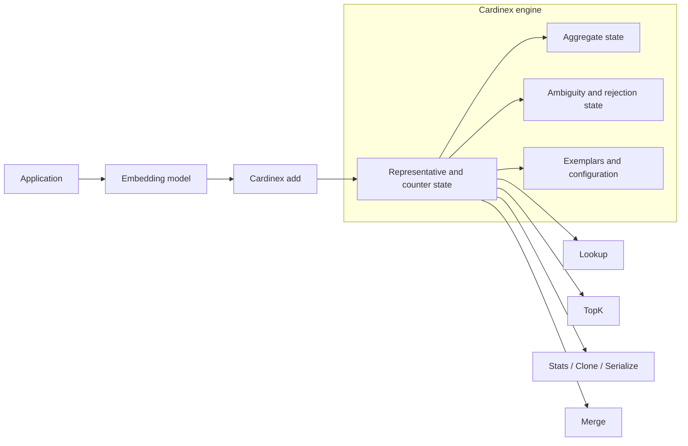
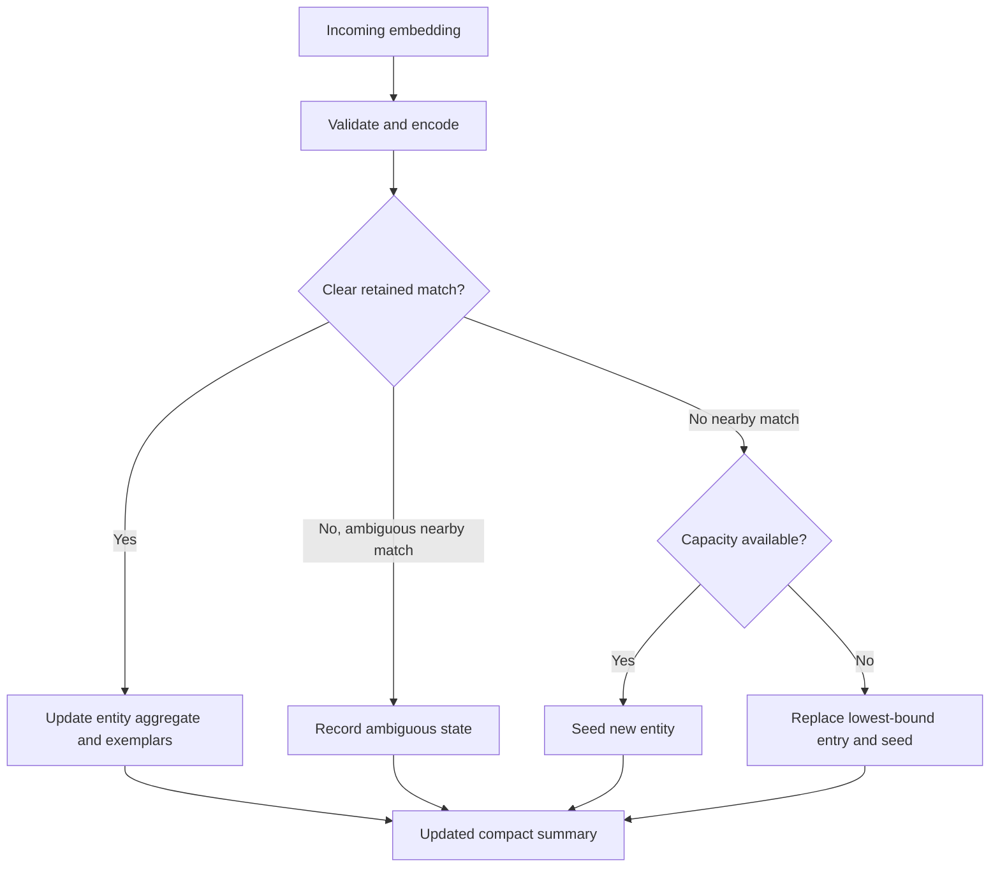
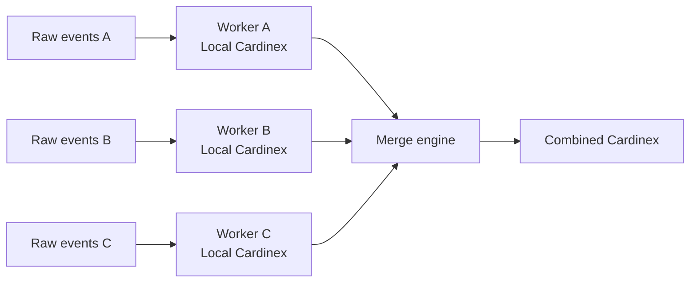

# Cardinex

**Cardinex is a bounded-memory semantic streaming data structure that organizes embeddings into compact semantic groups and maintains approximate frequency and aggregate information as new observations arrive.**

Applications supply embeddings from the model of their choice. Cardinex manages the resulting streaming summary, allowing an application to work with retained semantic groups instead of storing and repeatedly processing every individual embedding.

Cardinex is useful for continuous embedding streams that need semantic grouping, approximate counts and aggregates, frequent-group discovery, snapshots, compact persistence, and compatible distributed merging.

> **Implementation status:** the repository contains a working Go model-v0 semantic sketch, C ABI, SDK bindings, HTTP/MCP service, conformance fixtures, and tests. The public API documented below describes that implementation. Where this README uses a common conceptual name that does not exist as a method, it is explicitly labeled.

## Overview

Cardinex keeps a limited number of semantic representatives. When an embedding arrives, it is compared with those representatives. A clear match updates the associated summary; an unclear match is tracked separately; an unmatched embedding creates a representative or replaces the least-prominent retained entry when capacity is full.

The result is compact state that supports:

- continuous embedding ingestion;
- semantic grouping with configurable angular thresholds;
- approximate count, sum, and mean intervals per retained group;
- ranked retained groups through `TopK`;
- bounded item-ID exemplars;
- deep-copy snapshots through `Clone`;
- binary export/import through the CDNX format;
- merging compatible summaries from separate workers.

Cardinex does not generate embeddings, store original messages, deduplicate writes, or replace raw-data storage when exact retrieval is required.

## Why Cardinex?

Imagine a customer-support system receiving:

- “My payment failed.”
- “Transaction declined.”
- “I cannot complete checkout.”

A `HashMap` treats these as different keys. An embedding model can place similar messages near each other, but it does not maintain stream counts. A developer can assemble vector storage, similarity matching, clustering, counters, and periodic aggregation, but that leaves them responsible for coordinating state and enforcing a memory limit.

Cardinex provides an integrated, compact streaming abstraction for that job.

| Tool | Primary purpose | How Cardinex differs |
| --- | --- | --- |
| HashMap | Exact-key counting | Cardinex groups by embedding proximity rather than exact identity. |
| Vector database | Store and retrieve vectors | Cardinex maintains compact streaming statistics; it is not a retrieval store. |
| Clustering library | Build related groups | Cardinex focuses on incremental bounded state and aggregate maintenance. |
| Frequency sketch | Estimate counts for predefined keys | Cardinex creates and manages embedding-derived retained keys. |

These tools can be combined with Cardinex. Cardinex does not claim that they cannot reproduce parts of this workflow.

## How it works



### Engine lifecycle

1. The application receives an observation and generates an embedding.
2. It calls `Add` or `AddBatch` with the embedding, a bounded numeric value, and an item ID.
3. Cardinex validates and encodes the vector, then compares it with retained representatives.
4. A clear match updates a retained group. An ambiguous nearby match is recorded as ambiguous. An unmatched vector seeds a new entry or triggers bounded replacement.
5. The compact state can be read with `Lookup`, `TopK`, and `Stats`, copied with `Clone`, serialized, or merged with another compatible sketch.

## Internal components

### Representative and counter state

Model v0 stores a compact code for each retained representative and the aggregate/counter state associated with it. The configured `Capacity` limits the number of live entries. The implementation does **not** currently expose separate center-table and frequency-counter capacities; a single capacity bounds both.

Embeddings are normalized, transformed with a seeded randomized-Hadamard rotation, and stored as 1-, 2-, or 4-bit codes. Cardinex compares those codes using estimated angular distance. The engine uses a linear scan of live representatives.

### Aggregate state

Each retained entity tracks genuine observation count and value sum, inherited mass from replacement or merging, and enough information to return count, sum, and mean intervals. Values must fall within the configured `ValueMin` and `ValueMax` range.

### Ambiguity, unresolved, and rejection state

Cardinex deliberately does not force every nearby observation into a group. A configurable `Band` around `Tau` creates an ambiguity zone. Observations near more than one representative, or in this zone, are quarantined and reported separately from confident aggregates.

When capacity is full and a new representative is needed, the engine replaces the entry with the smallest retained upper bound. It records inherited and orphaned information so that replacement is not presented as exact deletion. Invalid vectors or values are rejected and counted in diagnostics.

### Exemplars

Each entity can retain up to `Exemplars` item IDs, chosen with a deterministic seeded priority. These IDs let an application retrieve examples from its own data store. Cardinex does not retain full original observations.

### Configuration and metadata

The semantic parameters include `Dim`, `Capacity`, `Tau`, `Band`, `Bits`, `ValueMin`, `ValueMax`, `Exemplars`, `Probation`, `Refine`, and `Seed`. Compatible configuration matters because independent sketches must encode and compare vectors in the same way before they can merge.

`Refine` is present in the parameter type but unsupported in model v0. `Stats` reports live usage, confident and quarantined mass, orphaned mass, rejection counts, and promotion/merge diagnostics.

## Getting started

### Go

```go
import (
    "fmt"

    cardinex "github.com/dippendicular/cardinex/sdk/go"
    "github.com/dippendicular/cardinex/core/semantic"
)

p := cardinex.DefaultSemanticParams(384, 0.6, 1)
p.Capacity = 4096

summary, err := cardinex.NewSemantic(p)
if err != nil {
    panic(err)
}

if err := summary.Add(embedding, 1.0, itemID); err != nil {
    panic(err)
}

if entity, ok := summary.Lookup(embedding); ok {
    fmt.Println(entity.ID, entity.Count.Lower, entity.Count.Upper)
}

for _, entity := range summary.TopK(10, cardinex.ByCount) {
    fmt.Println(entity.ID, entity.Count, entity.Exemplars)
}

snapshot := summary.Clone()
data, err := snapshot.MarshalBinary()
if err != nil {
    panic(err)
}
restored, err := semantic.Unmarshal(data)
if err != nil {
    panic(err)
}
_ = restored
```

### Python

```python
import numpy as np
import cardinex

with cardinex.Semantic(dim=384, tau=0.6, seed=1) as summary:
    summary.add_batch(embeddings.astype(np.float32), values=losses)
    print(summary.topk(10, by="mean"))
```

The Python binding uses the C ABI. The C ABI also supports zero-copy, row-major float32 batch input.

## Core API

### Creating a summary

**Implemented:** `semantic.New(params)` and `cardinex.NewSemantic(params)` create an empty semantic summary.

Creation validates the embedding dimension, capacity, threshold/band relationship, quantization width, value bounds, exemplar/probation limits, and unsupported refinement flag. It then initializes the encoder and empty state.

Use identical parameters for summaries that will be merged. The current implementation treats parameter equality as compatibility; it has no separate embedding-model-name field, so applications should enforce model provenance themselves.

### Adding observations

**Implemented:**

```go
err := summary.Add(embedding []float32, value float64, itemID uint64)
err := summary.AddBatch(vectors [][]float32, values []float64, itemIDs []uint64)
```

`Add` performs this flow:

1. Validates vector length, finite coordinates, nonzero norm, and value bounds.
2. Encodes the normalized vector into a compact code.
3. Finds retained representatives within the matching area.
4. Makes one of three decisions:
   - exactly one clear match: update that entity;
   - one or more ambiguous nearby matches: record ambiguous mass and do not add it to a confident entity;
   - no nearby match: seed an entity, replacing the lowest-upper-bound entry if capacity is full.
5. Updates genuine count/sum, bounded exemplars, and operational diagnostics for confident observations.
6. Runs the configured probation check when needed.



An `Add` call returns an error for invalid input. It does not return a structured assignment status. `AddBatch` is all-or-nothing: it validates every item first, returns the first failing index in `BatchError`, and does not apply a partially invalid batch.

Inserting the same observation twice processes it twice. Cardinex has no automatic deduplication or exactly-once guarantee. Counter replacement does not mean that an unrelated geometric record has been silently accepted as the replacement: inherited counter mass is tracked separately from genuine observations, and the new representative is seeded from the new vector.

### Querying semantic groups

**Implemented name:** `Lookup`, not `query`.

```go
entity, found := summary.Lookup(embedding []float32)
```

`Lookup` validates and encodes the input, searches retained representatives, and returns an entity only when there is exactly one clear match. The result includes its ID, count/sum/mean intervals, ambiguity attached to that entity, exemplar IDs, provisional state, and aliases.

`found == false` means the vector is invalid, unmatched, or ambiguous. It does not mean that a related concept has never appeared: it might be quarantined, fragmented across retained entities, or no longer explicitly monitored after replacement. `Lookup` does not return the merely nearest representative or a matching distance.

For a payment-related complaint, generate an embedding with the same model/configuration used for ingestion, then call `Lookup`. If it returns an entity, inspect `entity.Count`, `entity.Sum`, `entity.Mean`, and `entity.Exemplars`. If it does not, call `Unmonitored()` to read the sketch-wide bound for an unretained entity.

### Finding frequent semantic groups

**Implemented:**

```go
groups := summary.TopK(10, cardinex.ByCount)
// Other ranking modes: cardinex.BySum and cardinex.ByMean.
```

`TopK` reads live entities, derives their public aggregate views, sorts by the requested metric, and applies deterministic ID tie-breaking. Count and sum ranking use interval upper bounds; mean ranking uses the exposed mean value. `k <= 0` returns every retained entity.

The output ranks retained IDs, not perfectly reconstructed real-world concepts. One concept can occupy several centers, which splits its apparent frequency. Model v0 preserves aliases created during merge but does not provide general group reconciliation.

Illustrative output:

| Rank | Representative ID | Count interval | Example IDs |
| --- | ---: | ---: | --- |
| 1 | 8012 | 412–435 | `104`, `220`, `841` |
| 2 | 1297 | 201–219 | `502`, `878` |

The values above are examples, not benchmark results.

### Understanding memory usage

**Planned name:** `memory_bytes()` is not implemented in model v0.

The current engine is bounded by `Capacity`, but it does not expose a public analytical byte count. The maintained state includes compact representative codes, aggregate/counter fields, entity IDs, aliases, probation members, exemplar IDs, configuration, and Go container overhead. Precision (`Bits`) and padded embedding dimension affect code size.

Do not substitute process RSS for analytical state size: RSS includes the runtime, allocator, and unrelated application state. A future `memory_bytes()` API should report every maintained structure. It should also count any added indexes or projection state.

Model v0 has one shared capacity rather than separately tunable center and counter capacities. Developers can currently tune `Capacity`, `Bits`, `Exemplars`, and `Probation`; lower capacity or smaller codes reduce retained state at the cost of representation detail.

### Creating snapshots

**Implemented name:** `Clone`, not `snapshot`.

```go
snapshot := summary.Clone()
```

`Clone` locks the live sketch, deep-copies its representative, aggregate, uncertainty, exemplar, configuration, and diagnostic state, then returns an independent summary. Later writes to the live summary do not change the clone.

Use a clone for hourly reports, persistence staging, exports, or comparing application-level snapshots. `MarshalBinary` serializes a summary into CDNX bytes; `semantic.Unmarshal` restores those bytes. A clone is a stable in-memory logical state, while serialization is the portable representation of that state.

The implementation protects sketch methods with a mutex, including `Clone`, but it does not expose a multi-sketch transaction or a globally coordinated snapshot.

### Merging distributed summaries

**Implemented:**

```go
err := workerA.Merge(workerB)
```

`Merge` modifies the receiver and leaves the source summary unchanged. It requires both values to be semantic sketches with exactly equal parameters. The engine:

1. validates compatibility and avoids self-merge;
2. reads retained entries in deterministic ID order;
3. fuses clear compatible matches;
4. records aliases for ambiguous nearby representatives;
5. carries counter/aggregate uncertainty rather than treating estimates as exact observations;
6. applies floors for mass that is not explicitly represented on one side;
7. trims to `Capacity` and records dropped/orphaned information;
8. runs deferred probation checks.

The merged summary is compact and deterministic for the same pair of states. Because reconciliation and capacity trimming are lossy, applications should not expect every merge order to create identical semantic groupings.

## Distributed processing

Each worker ingests raw observations locally. Only compact summaries need to cross the network for merging.



Use the same model, dimension, thresholds, quantization settings, value range, seed, and remaining semantic parameters on every worker. If configurations differ, `Merge` returns an incompatibility error. If an application changes embedding models, begin a separate summary rather than merging incompatible vector spaces.

## Complete developer journey

This example uses customer-support analytics.

1. **Choose an embedding model.** Select a model and keep its dimension and preprocessing consistent for the lifetime of a summary.
2. **Create Cardinex.** Set `Dim`, `Tau`, `Capacity`, value range, and compression/exemplar settings with `DefaultSemanticParams` or `semantic.Params`.
3. **Ingest messages.** Persist the original message in application storage, generate its embedding, and call `Add(embedding, severity, itemID)`.
4. **Query an issue.** Embed “payment rejected at checkout” with the same model and call `Lookup`. A confident match returns its aggregate interval and exemplar IDs.
5. **Find frequent issues.** Call `TopK(10, ByCount)` to populate an approximate issue dashboard.
6. **Inspect state.** Call `Stats` to check live capacity, quarantined observations, replacement-related orphaned mass, and input rejections. A byte-level memory method is not yet available.
7. **Capture a reporting point.** Call `Clone` hourly and serialize the clone if it must leave the process.
8. **Scale out.** Run compatible summaries per worker, then merge into an aggregation summary when partitions complete.
9. **Display results.** Show count/sum/mean intervals and indicate ambiguity rather than presenting estimates as exact counts.

Conceptual APIs sometimes call steps 6 and 7 `memory_bytes()` and `snapshot()`. In this repository, use `Stats()` and `Clone()` respectively.

## Service and SDK integration

The C ABI in [`capi/cardinex.h`](capi/cardinex.h) exposes creation, semantic add/add-batch, top-k, lookup, diff, merge, stats, marshal, and unmarshal. SDK directories provide Go, Python, C++, C#, Java, Node.js, and Rust bindings.

The HTTP service exposes semantic creation, batch add, top-k, lookup, entity-delta diff, exemplars, stats, export/import, and merge routes. Service writes use `batch_id` for idempotency. With a requested tolerance, answers whose interval is wider than that value receive `insufficient_confidence`.

`Diff` is implemented as per-entity count/sum/mean delta comparison between compatible summaries. It is separate from `Merge` and should not be treated as a general semantic-distance or raw-data comparison API.

## Practical use cases

| Use case | Input and Cardinex operations | Expected output |
| --- | --- | --- |
| Customer feedback analytics | Message embeddings plus severity/sentiment values; `Add`, `Lookup`, `TopK`. | Retained complaint groups, approximate counts, aggregate intervals, example IDs. |
| LLM evaluation | Embeddings of failure descriptions plus bounded score/loss. | Repeated error-pattern summaries and aggregate score information. |
| Agentic AI monitoring | Embedded agent observations and tool failures; `Add`, `Stats`, `TopK`. | Recurring behavior or failure candidates with bounded summary state. |
| Training-data analytics | Embeddings and bounded quality signals. | Repetitive retained regions and lightweight aggregate summaries. |
| Distributed event processing | Per-worker summaries followed by compatible `Merge`. | Compact combined state without replaying raw events. |

## Configuration and memory management

`DefaultSemanticParams(dim, tau, seed)` supplies defaults. Customize fields before construction:

- `Capacity` controls the maximum number of live entries.
- `Tau` controls how close a clear match must be.
- `Band` reserves uncertainty around the threshold; larger bands report more ambiguous observations instead of forcing assignments.
- `Bits` selects compact-code precision: 1, 2, or 4.
- `ValueMin` and `ValueMax` must cover every supplied value.
- `Exemplars` limits retained item IDs per entity.
- `Probation` controls how provisional representatives are checked; zero disables it.
- `Seed` must match across sketches that need to merge.

Tune capacity and compression against the quality your application needs. Watch `Stats().Live`, `Stats().Wq`, `Stats().Orphaned`, and rejection counters; they reveal saturation, ambiguity, replacement effects, and bad inputs.

## Limitations

- Statistics are approximate and include intervals or ambiguity metadata.
- Similar embeddings are not necessarily the same real-world concept.
- A concept can fragment across multiple retained entities.
- Capacity saturation causes replacement and can reduce representation quality.
- Model v0 has one shared capacity, not separate center/counter budgets.
- `Lookup` returns only clear matches; it does not provide arbitrary nearest-neighbor retrieval.
- Merging requires exact configuration compatibility and may be sensitive to merge order.
- Changing embedding models or preprocessing invalidates direct comparison and merging.
- Cardinex retains item IDs, not raw data; use your own storage for exact retrieval.

## Roadmap

Possible future work includes a public analytical `memory_bytes()` method, a named snapshot API, separate geometric and frequency budgets, richer semantic-group reconciliation, and additional distribution-comparison operations. These are not available features in model v0.

## Repository layout and installation

| Path | Contents |
| --- | --- |
| `core/semantic` | Semantic sketch, aggregation, query, merge, and serialization. |
| `core/quant` | Embedding rotation and compact encoding. |
| `core/classic` | HyperLogLog, Count-Min, and Bloom sketches. |
| `capi` | C ABI. |
| `sdk` | Language bindings. |
| `service` | HTTP and MCP services. |
| `conformance`, `bench`, `experiments` | Fixtures, benchmarks, and utilities. |

```sh
make build        # Build Go packages
make test         # Run Go tests
make lib          # Build the native library (C compiler required)
make conformance  # Run Go + Python conformance path
make cross        # Cross-build with zig cc
docker compose up --build
```

Service configuration: `ADDR`, `REDIS_ADDR`, `FLUSH_INTERVAL` (default `5s`), `LOG_WRITES` (default `1`), and `CARDINEX_API_KEY`.

## License and contributing

Cardinex is available under the [MIT License](LICENSE). Contributions should preserve API accuracy, document compatibility requirements, and keep planned features clearly separate from implemented behavior.
