# Cardinex

**A bounded-memory semantic streaming data structure for embedding-based aggregation.**

Cardinex takes embeddings produced by your application, assigns confident observations to retained semantic representatives, and maintains compact count, sum, mean, and exemplar state. It also tracks observations that cannot be assigned confidently, supports snapshots and binary persistence, and merges compatible summaries produced by different workers.

Cardinex does not generate embeddings, retain raw messages, perform automatic event deduplication, or provide a general-purpose vector search index.

## Contents

- [Why Cardinex](#why-cardinex)
- [End-to-end architecture](#end-to-end-architecture)
- [What the engine stores](#what-the-engine-stores)
- [Quick start](#quick-start)
- [API execution flows](#api-execution-flows)
  - [NewSemantic](#1-newsemantic-creating-a-summary)
  - [Add](#2-add-ingesting-one-observation)
  - [AddBatch](#3-addbatch-ingesting-a-batch)
  - [Lookup](#4-lookup-querying-a-semantic-representative)
  - [TopK](#5-topk-ranking-retained-entities)
  - [Unmonitored](#6-unmonitored-querying-an-entity-without-a-counter)
  - [Stats](#7-stats-reading-operational-state)
  - [Clone](#8-clone-creating-a-point-in-time-copy)
  - [MarshalBinary](#9-marshalbinary-exporting-state)
  - [Unmarshal and UnmarshalBinary](#10-unmarshal-and-unmarshalbinary-restoring-state)
  - [Merge](#11-merge-combining-worker-summaries)
  - [Diff](#12-diff-comparing-two-summaries)
  - [Other public helpers](#13-other-public-helpers)
  - [memory_bytes](#14-memory_bytes-planned-not-implemented)
- [Complete developer journey](#complete-developer-journey)
- [Distributed execution](#distributed-execution)
- [Configuration](#configuration)
- [SDKs and service](#sdks-and-service)
- [Operational boundaries](#operational-boundaries)
- [Repository and build](#repository-and-build)

## Why Cardinex?

Suppose a support application receives these messages.

- “My payment failed.”
- “Transaction declined.”
- “I cannot complete checkout.”

A hash map counts them as different strings. An embedding model turns them into vectors, but does not maintain streaming frequencies. A vector database can retrieve nearby vectors, but retaining and searching vectors is a different job from maintaining a small, continuously updated statistical summary.

Cardinex gives the application one stateful interface for semantic assignment, bounded aggregation, uncertainty tracking, and distributed summary operations. It can be used alongside raw-data storage, an embedding model, and a vector database.

| System | Main job |
| --- | --- |
| Hash map | Count exact keys. |
| Vector database | Store and retrieve individual vectors. |
| Clustering library | Partition or group observations. |
| Frequency sketch | Approximate counts for existing keys. |
| **Cardinex** | Create retained embedding-derived entities and maintain compact streaming statistics about them. |

## End-to-end architecture

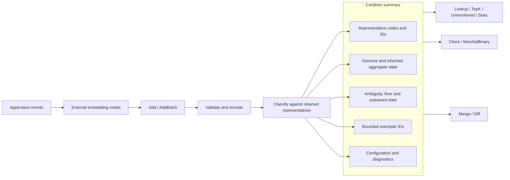

The engine processes vectors, not raw text. The embedding model must remain consistent across ingestion, lookup, and summaries intended for merging. Model v0 does not store an embedding-model identifier, so the application must enforce that compatibility.

## What the engine stores

The semantic engine is implemented in [`core/semantic`](core/semantic). Model v0 has **one `Capacity` limit** for live entries. It does not have separately configurable center-table and counter-table capacities.

| State | Actual purpose | Updated by |
| --- | --- | --- |
| Representative identity | Entity ID, compact vector code, provisional status, aliases and probation members. | `Add`, probation, `Merge` |
| Genuine aggregate | Count of confidently assigned observations and their compensated value sum. | `Add`, probation, `Merge` |
| Inherited aggregate | Counter mass and sum uncertainty carried through replacement or merging. | Seeding, replacement, `Merge` |
| Entity ambiguity | Quarantined count and value sum attached to nearby candidates. | Ambiguous `Add`, probation, `Merge` |
| Global uncertainty | Quarantined mass, orphaned mass, floor and unmonitored upper bound. | `Add`, probation, replacement, `Merge` |
| Exemplars | Up to `Exemplars` distinct item IDs chosen by seeded priority. | `Add`, probation, `Merge` |
| Diagnostics | Rejection reasons, promotions, re-anchors, dissolutions, fusions, aliases and drops. | Mutating operations |

### How embeddings are represented

The encoder normalizes a valid vector, pads its dimension to a power of two, applies three rounds of seeded randomized-Hadamard rotation, then quantizes the rotated coordinates to **1, 2 or 4 bits**. The stored representative is a compact `quant.Code`, not the original float embedding. Candidate matching uses estimated angular distance between codes. Model v0 scans retained representatives linearly.

### How an entity's count differs from its counter estimate

A retained entry stores genuine count and sum separately from inherited mass. When an entry is replaced, the new representative starts from the incoming observation, while inherited counter uncertainty is retained as accounting metadata. This prevents an evicted entity's historical estimate from being mistaken for genuine observations of the new entity.

### How a match is classified

Cardinex scans for **all** retained representatives within `Tau + Band`, then sorts candidates by estimated distance and entity ID.

- **Confident** only when there is exactly one candidate and its distance is at most `Tau - Band`.
- **Ambiguous** when there is at least one nearby candidate but the confident rule fails. This includes a single candidate in the uncertainty band and multiple nearby candidates.
- **Unmatched** when there are no candidates within `Tau + Band`.

The distinction matters because `Lookup` and `Add` use the same classification rule. Nearest does not necessarily mean confidently matched.

## Quick start

### Go

```go
package main

import (
    "fmt"

    "github.com/dippendicular/cardinex/core/semantic"
    cardinex "github.com/dippendicular/cardinex/sdk/go"
)

func main() {
    params := cardinex.DefaultSemanticParams(384, 0.6, 1)
    params.Capacity = 4096

    summary, err := cardinex.NewSemantic(params)
    if err != nil {
        panic(err)
    }

    // Replace this illustrative vector with a real model embedding.
    vector := make([]float32, 384)
    vector[0] = 1

    if err := summary.Add(vector, 1.0, 101); err != nil {
        panic(err)
    }

    if entity, found := summary.Lookup(vector); found {
        fmt.Println(entity.ID, entity.Count, entity.Sum, entity.Mean)
    }

    for _, entity := range summary.TopK(10, cardinex.ByCount) {
        fmt.Println(entity.ID, entity.Count, entity.Exemplars)
    }

    fmt.Println(summary.Stats())

    snapshot := summary.Clone()
    data, err := snapshot.MarshalBinary()
    if err != nil {
        panic(err)
    }
    restored, err := semantic.Unmarshal(data)
    if err != nil {
        panic(err)
    }
    _ = restored
}
```

### Python

```python
import numpy as np
import cardinex

# embeddings and values are supplied by the application.
with cardinex.Semantic(dim=384, tau=0.6, seed=1) as summary:
    summary.add_batch(embeddings.astype(np.float32), values=values)
    print(summary.topk(10, by="count"))
```

The Python SDK uses the C ABI. Its batch input supports row-major `float32` arrays. SDK naming may differ from the Go methods documented below.

## API execution flows

The following sections describe the **implemented Go semantic engine**, rather than hypothetical APIs. Each operation explains the caller input, processing order, state changes, return value, and failure behavior. Internal steps are based on [`sketch.go`](core/semantic/sketch.go), [`query.go`](core/semantic/query.go), [`merge.go`](core/semantic/merge.go), and [`serialize.go`](core/semantic/serialize.go).

### 1. `NewSemantic()` creating a summary

```go
params := cardinex.DefaultSemanticParams(384, 0.6, 1)
params.Capacity = 4096
summary, err := cardinex.NewSemantic(params)
```

**Execution flow**

1. Receive `semantic.Params`, including dimension, capacity, thresholds, precision, value bounds, exemplar limit, probation limit and seed.
2. Validate positive dimension and capacity, supported bit width, valid threshold/band relationship, nonnegative finite value range, and exemplar/probation limits.
3. Reject `Refine = true`, which is not implemented in model v0.
4. Create a seeded quantization encoder for the configured dimension and bit width.
5. Allocate a new sketch identity and initialize empty representative and aggregate state.
6. Return the new sketch or a configuration error.

**State after success**

The sketch has no live entities, no observations, and zero operational counters. Its encoder and parameters are ready for ingestion. `DefaultSemanticParams` supplies defaults; it does not itself allocate a sketch.

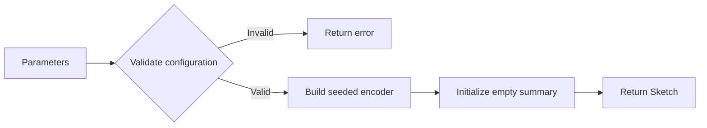

### 2. `Add()` ingesting one observation

```go
err := summary.Add(vector, value, itemID)
```

**Input**

- `vector` is a `[]float32` matching the configured dimension.
- `value` is a finite `float64` within `ValueMin` and `ValueMax`.
- `itemID` is a `uint64` used for entity seeding and optional exemplars.

**Execution flow**

1. Check the value range. The encoder checks vector length, finite coordinates and nonzero norm.
2. Normalize, zero-pad, rotate and quantize the vector into a compact code.
3. Lock the sketch for the state update. Invalid input increments the appropriate rejection diagnostic and returns an error without ingesting the observation.
4. Scan all retained codes for candidates at estimated angular distance no greater than `Tau + Band`.
5. Sort candidates by distance and entity ID, then choose the confident, ambiguous or unmatched branch.
6. **Confident branch.** Increment the matched entry's genuine count, add the value using compensated summation, increment its confident-observation diagnostic, offer the item ID to its bounded exemplar set, and update global confident count and sum.
7. **Ambiguous branch.** Increment global quarantined count and sum **once**. Attach ambiguous count and sum to up to the two nearest candidate entries. Do **not** increment a confident entity's genuine count or sum.
8. **Unmatched branch.** Calculate the current unmonitored upper bound. If capacity is available, append a new entry. If full, choose the entry with the lowest count upper bound, breaking ties by lower entity ID, remove it, and record its attached ambiguous count as orphaned.
9. Seed the new entry from the incoming code with genuine count `1` and genuine sum `value`. Record inherited uncertainty separately, generate a seeded entity ID, initialize provisional status if probation is enabled, and offer the seed item as an exemplar.
10. If the confident match belongs to a provisional entry, add a distinct probation member when eligible. Once the configured member threshold is reached, run the probation decision described below.
11. Release the lock and return `nil` on successful processing.

**Probation flow**

1. A newly seeded entry is provisional when `Probation > 0`.
2. Later confident assignments contribute compact member codes and distinct item IDs, up to the configured probation limit.
3. When enough members exist, compare the stored members pairwise.
4. If they are not mutually compatible, dissolve the entry. Its genuine mass moves to global quarantined accounting, its attached ambiguity becomes orphaned, and the floor is updated.
5. If members are mutually compatible but not all compatible with the original seed representative, re-anchor the representative to the first member. If the seed is still live, remove its genuine contribution and transfer that observation to quarantine.
6. Otherwise, or after a successful re-anchor, mark the entry non-provisional, clear probation members and increment the promotion diagnostic.

**Return and side effects**

`Add` returns only `error`, not an assignment-status object. A valid but ambiguous observation is processed successfully and returns `nil`. Invalid input increments rejection diagnostics. Repeated calls with the same observation are counted repeatedly. There is no core exactly-once guarantee.

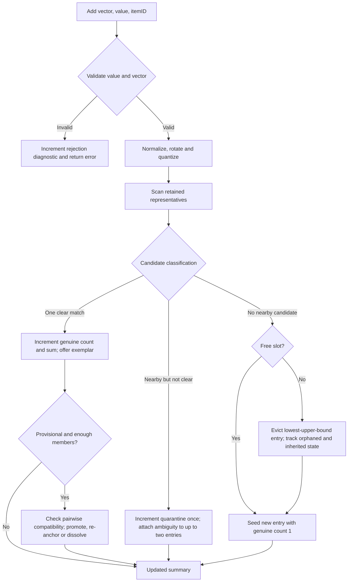

**Implementation detail**

The replacement decision uses an entry's **upper bound**, not its genuine count. The replacement's inherited mass is approximation metadata and is not added to its genuine count. A newly seeded representative is based on the incoming vector, not the evicted representative's geometry.

### 3. `AddBatch()` ingesting a batch

```go
err := summary.AddBatch(vectors, values, itemIDs)
```

**Execution flow**

1. Check that the vector, value and item-ID slices have identical lengths. Return `ErrBatchLength` otherwise.
2. Validate and encode **every** observation before ingesting any of them.
3. If item `i` is invalid, increment the appropriate rejection diagnostic and return `*BatchError` containing the first failing index and underlying error.
4. On validation failure, apply **none** of the batch's observations to the semantic summary. The rejection diagnostic is the exception to the no-state-change behavior.
5. When all items are valid, acquire the sketch lock once.
6. Ingest encoded observations **in original index order**, using the same classification, seeding, replacement, ambiguity and probation logic as `Add`.
7. Release the lock and return `nil`.

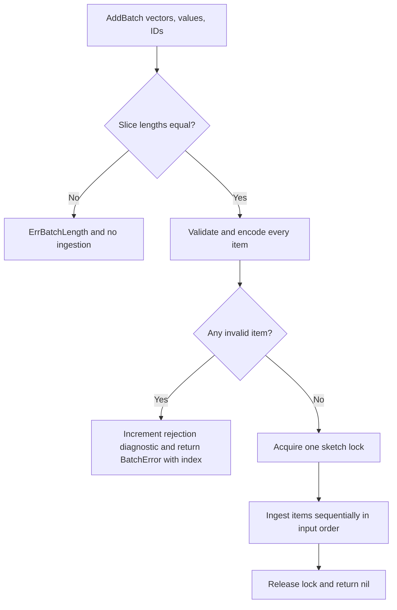

**Important behavior**

`AddBatch` is all-or-nothing for observation ingestion, not a database transaction spanning external storage. Duplicate item IDs do not make ingestion idempotent. Batch order can affect representative creation and replacement.

### 4. `Lookup()` querying a semantic representative

```go
entity, found := summary.Lookup(vector)
```

**Execution flow**

1. Encode the supplied vector with the sketch's existing encoder. Invalid vectors immediately return `Entity{}` and `false`.
2. Acquire the sketch lock and scan live representatives within `Tau + Band`.
3. Sort candidates by estimated distance and entity ID.
4. Apply the same confident-match rule as `Add`, requiring **exactly one** nearby candidate within `Tau - Band`.
5. If the match is ambiguous or absent, return an empty entity and `false`.
6. On a confident match, construct a public `Entity` view from the retained entry.
7. Derive count, sum and mean estimates and their lower/upper bounds from genuine and inherited state.
8. Copy exemplar IDs and aliases, include attached ambiguous count/sum and provisional status, then return the entity and `true`.

**State mutation**

None. `Lookup` does not add an observation, update exemplars, or increment input-rejection diagnostics.

**Output**

The returned entity contains `ID`, `Count`, `Sum`, `Mean`, `Ambiguous`, `AmbiguousSum`, `Exemplars`, `Provisional`, and `Aliases`. It does **not** return the nearest distance or a list of neighboring entities.

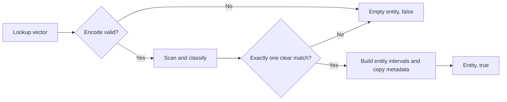

`found == false` does not mean the semantic concept never occurred. It may have been quarantined, fragmented, or removed from retained state by capacity replacement.

### 5. `TopK()` ranking retained entities

```go
groups := summary.TopK(10, cardinex.ByCount)
// Alternative orders are BySum and ByMean.
```

**Execution flow**

1. Acquire the sketch lock.
2. Walk every live counter/representative entry.
3. Build a public `Entity` view for each, including count, sum, mean intervals, ambiguity, exemplars and aliases.
4. Select a ranking value. `ByCount` uses `Count.Upper`; `BySum` uses `Sum.Upper`; `ByMean` uses `Mean.Value`.
5. Sort descending by the selected value.
6. Break equal-ranking ties by **ascending entity ID**.
7. If `k > 0`, return at most `k` entries. If `k <= 0`, return all retained entries.
8. Release the lock and return the entity slice.

**State mutation**

None. `TopK` ranks retained entity IDs, not guaranteed reconstructed real-world semantic concepts. Ambiguous mass is exposed separately rather than silently added to confident counts.

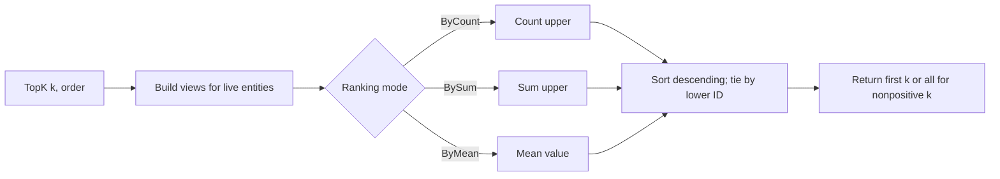

### 6. `Unmonitored()` querying an entity without a counter

```go
count, sum := summary.Unmonitored()
```

**Execution flow**

1. Acquire the sketch lock.
2. Read the current global floor.
3. If the sketch is full, find the smallest count upper bound among retained entries and take the larger of that bound and the floor. If it is not full, use the floor alone.
4. Build the count interval for an entity with no retained counter, starting at zero and ending at the computed upper bound.
5. Build the corresponding value-sum interval using the configured maximum value.
6. Release the lock and return both estimates.

**State mutation**

None. This is a sketch-wide uncertainty bound for an **unmonitored** entity. It does not retrieve a missing entity or assert that its frequency is zero.

### 7. `Stats()` reading operational state

```go
stats := summary.Stats()
```

**Execution flow**

1. Acquire the sketch lock.
2. Read global confidently aggregated count and value sum (`W`, `WSum`).
3. Read globally quarantined count and value sum (`Wq`, `WqSum`).
4. Read orphaned count, global floor, configured capacity and current number of live entries.
5. Recompute the current unmonitored upper bound (`Ubar`) from the floor and retained entries.
6. Copy rejection counters for dimension, non-finite vector, zero norm and invalid value.
7. Copy probation and merge diagnostics, including `Promoted`, `ReAnchored`, `Dissolved`, `Fused`, `Aliased` and `Dropped`.
8. Release the lock and return a by-value `Stats` object.

**State mutation**

None. `Stats()` is a consistent sketch-level diagnostic read, not a byte-level memory measurement.

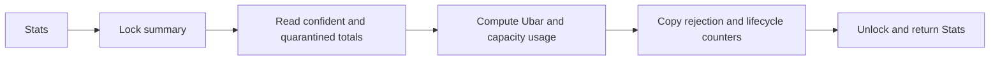

Use `Live`, `Capacity`, `Wq`, `Orphaned`, `Floor` and `Ubar` to inspect saturation and uncertainty. A high `Wq` means observations were not confidently assigned; `Orphaned` tracks quarantined count whose counter was evicted, dropped or dissolved.

### 8. `Clone()` creating a point-in-time copy

```go
snapshot := summary.Clone()
```

**Execution flow**

1. Acquire the source sketch lock.
2. Allocate a new sketch identity for the clone.
3. Copy configuration and all sketch-wide totals and diagnostics.
4. Reuse the existing encoder reference, which is immutable after construction.
5. Allocate a new live-counter slice.
6. Deep-copy each counter's aggregate and uncertainty values, representative code words, aliases, probation member codes and exemplar list.
7. Release the source lock and return an independent mutable sketch.

**State mutation**

The original sketch is unchanged. Subsequent `Add` or `Merge` operations on either sketch do not mutate the other's live counters. The immutable encoder may be shared safely.

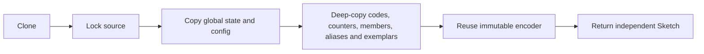

`Clone()` is the implemented snapshot operation. There is no separate public `snapshot()` method in model v0. A clone is an in-memory sketch, not serialized bytes.

### 9. `MarshalBinary()` exporting state

```go
data, err := summary.MarshalBinary()
```

**Execution flow**

1. Acquire the sketch lock to obtain a consistent state view.
2. Encode the sketch configuration, including dimension, capacity, thresholds, bit width, value bounds, exemplar/probation limits and seed.
3. Encode sketch-wide counters, compensated sums, rejection diagnostics and lifecycle diagnostics.
4. Write the number of retained entries.
5. For each entry, encode genuine and inherited aggregate fields, ID and compact code, provisional/seed metadata, aliases, probation members, ambiguity fields and exemplars.
6. Wrap the parameter bytes and payload in the versioned **CDNX semantic envelope**.
7. Release the lock and return the byte slice or an error.

**State mutation**

None. The resulting bytes are a portable representation of the state captured under the lock.

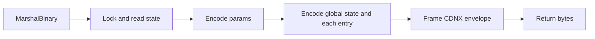

### 10. `Unmarshal()` and `UnmarshalBinary()` restoring state

```go
restored, err := semantic.Unmarshal(data)

// Or replace an existing sketch's state.
err = summary.UnmarshalBinary(data)
```

**Execution flow**

1. Read and validate the CDNX envelope for the semantic sketch kind.
2. Decode configuration fields and reject malformed or excessively large dimensions/capacities.
3. Construct a fresh temporary sketch using the decoded parameters and seeded encoder.
4. Decode global counts, sums, floors, rejection counters and lifecycle diagnostics.
5. Decode retained entries, compact code lengths, inherited and genuine aggregates, aliases, probation members, ambiguity and exemplars.
6. Validate encoded structures, including code size, finite numeric fields, unique retained IDs, exemplar ordering and configured limits.
7. If decoding fails, return an error. `UnmarshalBinary` leaves the existing receiver unchanged.
8. If decoding succeeds, lock the receiver and replace its configuration, encoder, counters and global state with the decoded temporary state.
9. Return the restored sketch or `nil` error.

**Difference between the two functions**

`semantic.Unmarshal(data)` creates a new sketch. `summary.UnmarshalBinary(data)` replaces the receiver's state only after the temporary decode succeeds.

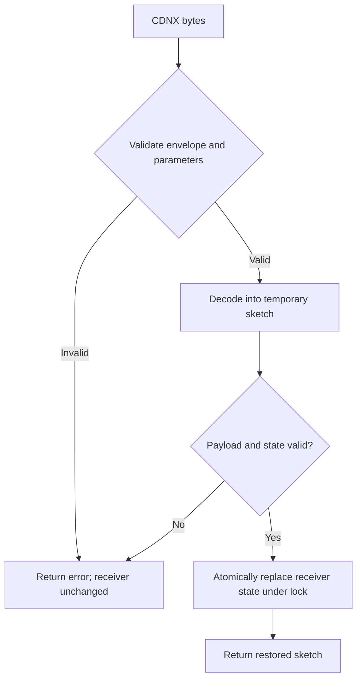

### 11. `Merge()` combining worker summaries

```go
err := workerA.Merge(workerB)
```

**Input and mutation contract**

The receiver (`workerA`) is modified in place. The source (`workerB`) remains unchanged. The method accepts a sketch interface, but the source must be a semantic sketch with **exactly equal parameters**. It rejects self-merge and incompatible sketches.

**Execution flow**

1. Check the source sketch type, reject self-merge and compare parameter structs for exact equality.
2. Lock both sketches in instance-sequence order to avoid lock-order deadlock.
3. Compute each side's unmonitored upper bound before merging.
4. Preserve the receiver's pre-merge entry list as the geometric reconciliation reference.
5. Sort source entries by ascending entity ID.
6. For each source entry, classify its compact representative code against the receiver's **pre-merge** entries, not newly added entries.
7. **Confident match.** Fuse genuine counts and compensated sums, inherited uncertainty, attached ambiguity, exemplar sets and aliases into the receiver entry. The destination keeps its representative code.
8. **Ambiguous nearby match.** Clone the source entry and create bidirectional aliases with up to two nearby receiver entries. Do not confidently fuse their counts.
9. **No nearby match.** Clone the source entry into the candidate merged set.
10. Add the opposite sketch's unmonitored upper bound as a floor contribution to entries not confidently fused across sides.
11. Combine existing and added entries. If the total exceeds `Capacity`, sort by descending count upper bound, tie-break by ascending ID, keep the first `Capacity` entries, and update floor, orphaned mass and drop diagnostics for removed entries.
12. Add global confident and quarantined totals, compensated sums, orphaned mass, rejection counters and lifecycle diagnostics from the source.
13. Run any deferred probation checks for eligible fused provisional entries, in ascending ID order.
14. Unlock both sketches and return `nil`.

**Important behavior**

The merge is deterministic for the same two states and execution order, but it is not promised to be exactly associative across arbitrary merge trees. Aliasing is not the same as confidently fusing entities. Inherited mass is carried as approximation metadata rather than relabeled as genuine observations.

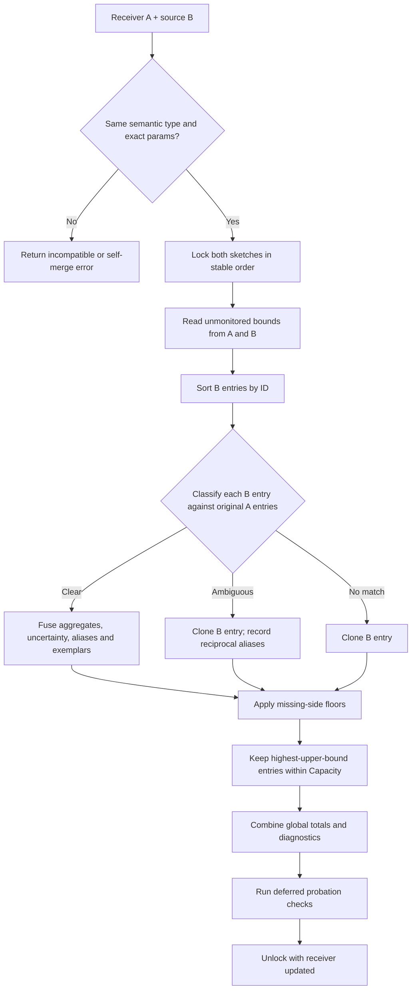

### 12. `Diff()` comparing two summaries

```go
deltas, err := current.Diff(previous)
```

**Meaning of the result**

The implemented operation returns **entity-level `current - previous` differences** for count, sum and mean. It does not compute Wasserstein distance, embedding-space transport, or an overall semantic drift score.

**Execution flow**

1. Reject comparison of the sketch with itself and reject unequal parameter configurations.
2. Lock both sketches in stable instance order.
3. Compute each sketch's unmonitored upper bound.
4. Build fallback entity intervals representing an entity absent from one side's retained counters.
5. Sort the receiver's entries by entity ID.
6. For each receiver entry, classify its representative code against the other sketch using the same matching rule as `Merge`.
7. **Confidently matched.** Construct both public entity views, subtract count/sum/mean intervals, record both IDs and mark both sides present.
8. **Not confidently matched.** Compare the receiver entity against the other side's unmonitored fallback interval and mark the result as receiver-only.
9. Iterate the other sketch's entries in ID order. For every entry not used by a confident match, compare the receiver's unmonitored fallback against that entity and mark the result as other-only.
10. Mark `Significant = true` when the resulting **count-difference interval excludes zero**.
11. Return results in this order, matched pairs, receiver-only entries, then other-only entries. Unlock both sketches.

**State mutation**

None. `Diff` does not merge, insert, or modify either summary.

**Result fields**

Each `EntityDelta` includes `IDA`, `IDB`, `InA`, `InB`, count/sum/mean difference estimates and `Significant`. Missing IDs are represented as zero, with presence flags clarifying which side contains the entry.

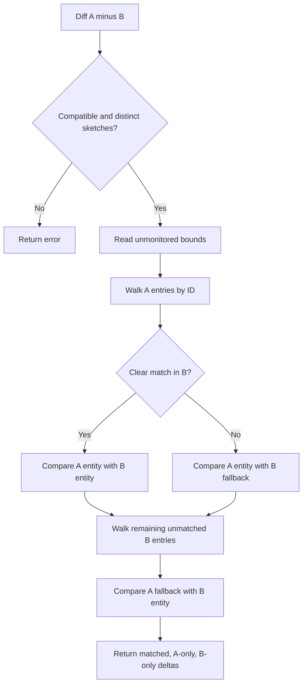

**How to interpret `Significant`**

It means the computed count-difference interval is strictly above or below zero. It is not a statistical hypothesis test or a guarantee that two embedding distributions are globally different.

### 13. Other public helpers

These are smaller operations but still have defined execution behavior.

| Function | Execution flow | Return / effect |
| --- | --- | --- |
| `DefaultSemanticParams(dim, tau, seed)` | Construct a parameter value with default capacity, band, bit width, value range, exemplar limit and probation setting. | Returns a configuration value; does not create a sketch. |
| `Params()` | Read the sketch's stored parameter struct. | Returns configuration by value; no mutation. |
| `Encoder()` | Return the sketch's initialized encoder reference. | The encoder is immutable after construction and can be reused for compatible codes. |
| `Kind()` | Return the semantic sketch-kind identifier. | Used by generic sketch and serialization dispatch. |
| `TauRange(...)` | Validate geometric inputs and calculate an allowable threshold range. | Returns lower/upper threshold values or an error. Optional configuration helper, not part of ingestion. |
| `TauFor(...)` | Call `TauRange`, then select the midpoint of its valid interval. | Returns a suggested threshold or an error. |
| `cardinex.New(kind, params)` | Dispatch to the registered sketch constructor by kind and JSON parameters. | Returns a generic sketch or an error. |
| `cardinex.Decode(bytes)` | Inspect the CDNX kind and dispatch to the corresponding decoder. | Returns a generic restored sketch or an error. |

`quant.Code.Clone()` also deep-copies packed code words. `quant.Encoder.Encode()` performs validation, normalization, rotation and quantization. `quant.Encoder.Distance()` estimates angular distance between compatible compact codes. These are lower-level quantization operations, not separate semantic-summary mutations.

### 14. `memory_bytes()` planned, not implemented

Model v0 does **not** expose a public `memory_bytes()` method. `Stats()` reports capacity and operational counts, not analytical byte usage.

A future byte-accounting operation would need to inspect the sketch configuration, packed representative codes, counter and aggregate fields, aliases, probation members, exemplar arrays, encoder state and other retained metadata. It should report an analytical state-size estimate rather than process RSS.

Likewise, `snapshot()` is not a separate public method. Use `Clone()`.

## Complete developer journey

A customer-support analytics service can use the functions together in this sequence.

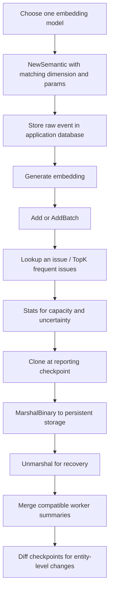

1. **Configure.** Pick an external embedding model and a consistent preprocessing policy. Create a sketch with matching `Dim`, `Tau`, `Band`, `Bits`, `Capacity` and `Seed`.
2. **Ingest.** Keep raw messages in your own database. Embed each message and call `Add` or `AddBatch` with a bounded score and an item ID.
3. **Investigate a concept.** Embed a representative question and call `Lookup`. If a clear entity is returned, inspect its count/sum/mean intervals and exemplar IDs. Fetch human-readable examples from your own database.
4. **Rank current issues.** Call `TopK` to obtain the highest-ranked retained entities. Display approximation intervals rather than claiming exact counts.
5. **Monitor uncertainty.** Call `Stats`. Track `Live`, `Wq`, `Orphaned`, rejection counters and promotion/replacement-related diagnostics.
6. **Create a reporting checkpoint.** Call `Clone`, then `MarshalBinary` to store a consistent summary. Use `Unmarshal` when restoring it.
7. **Scale horizontally.** Maintain one compatible sketch per worker or partition. Merge completed summaries into an aggregation sketch.
8. **Compare reporting periods.** Call `Diff` between compatible checkpoints to obtain per-entity count, sum and mean changes. Treat unmatched entities and wide intervals cautiously.

## Distributed execution

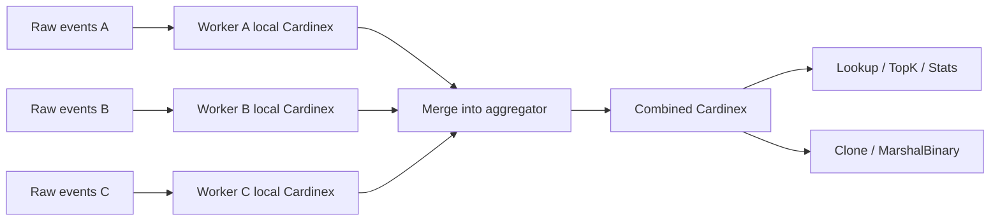

Only compact summary state needs to cross the network for a merge. `Merge` operates on compatible sketch instances and modifies its receiver. If an application requires the original worker summaries to remain unchanged, merge into a clone rather than directly into a worker's live sketch.

**Compatibility requirement**

Model v0 compares the full parameter struct. It does not verify external embedding-model provenance. Workers must therefore use the same embedding model and preprocessing, as well as identical Cardinex parameters. Different merge orders can yield different retained semantic groupings because reconciliation and capacity trimming are lossy.

## Configuration

| Parameter | Runtime effect |
| --- | --- |
| `Dim` | Required vector dimension; invalid lengths are rejected. |
| `Capacity` | Maximum number of retained live entries; full capacity triggers lowest-upper-bound replacement for unmatched observations. |
| `Tau` | Center of the angular matching threshold. |
| `Band` | Ambiguity band. A confident match must be uniquely within `Tau - Band`; candidates are considered through `Tau + Band`. |
| `Bits` | Packed code precision, 1, 2 or 4 bits. |
| `ValueMin`, `ValueMax` | Allowed nonnegative finite observation value range. |
| `Exemplars` | Maximum retained distinct item IDs per entity. |
| `Probation` | Number of distinct member codes required for a provisional promotion check; zero disables probation. |
| `Seed` | Controls deterministic encoding and seeded policies; must match for merges. |
| `Refine` | Unsupported in model v0; enabling it causes construction to fail. |

Lower code precision reduces representative storage but can change estimated angular distances and therefore assignment decisions. Increasing `Capacity` permits more retained entities but also increases scan work and state size.

## SDKs and service

The repository contains a pure-Go SDK, a C ABI, and bindings for Python, C++, C#, Java, Node.js and Rust. The HTTP service exposes semantic creation, batch ingestion, lookup, top-k, per-entity diff, exemplars, stats, export/import and merge routes.

The service supports `batch_id` for idempotent writes. This service-level behavior does **not** make the core `Add` API deduplicating or exactly-once. Service response tolerance handling may report `insufficient_confidence` when an estimate interval is too wide.

The Go function names in this README are the authoritative names for the Go semantic engine. Other SDKs may use different naming conventions and signatures.

## Operational boundaries

- Similar embeddings are not guaranteed to be the same real-world concept.
- The confident-match rule can quarantine a vector even when a nearest representative exists.
- An observation can be attached as ambiguity to up to two candidate entries, while global quarantined mass counts it once.
- One semantic concept may fragment across multiple retained representatives.
- A full sketch may evict a retained entry when an unmatched observation arrives.
- Counter inherited mass is approximation accounting, not genuine observations of the replacement entity.
- `Lookup` returns a clear entity or `false`; it is not a nearest-neighbor retrieval API.
- `TopK` ranks retained IDs, not guaranteed canonical semantic topics.
- `Diff` compares entity aggregate intervals, not embedding-distribution distance.
- `Merge` requires exact parameter compatibility and may depend on merge order.
- `AddBatch` prevalidates the full batch but may increment rejection diagnostics on failure.
- Raw messages are not stored, and core ingestion does not deduplicate repeated observations.
- Analytical byte-level `memory_bytes()` and a separately named `snapshot()` API are not implemented.

## Repository and build

| Path | Responsibility |
| --- | --- |
| [`core/semantic`](core/semantic) | Semantic ingestion, matching, aggregation, query, merge, diff and serialization. |
| [`core/quant`](core/quant) | Normalization, randomized-Hadamard rotation, compact codes and angular-distance estimates. |
| [`core/classic`](core/classic) | HyperLogLog, Count-Min and Bloom implementations. |
| [`capi`](capi) | Native C ABI. |
| [`sdk`](sdk) | Language bindings. |
| [`service`](service) | HTTP and MCP services. |
| [`conformance`](conformance), [`bench`](bench), [`experiments`](experiments) | Fixtures, benchmarks and utilities. |

```sh
make build
make test
make lib
make conformance
make cross
docker compose up --build
```

Service configuration includes `ADDR`, `REDIS_ADDR`, `FLUSH_INTERVAL`, `LOG_WRITES` and `CARDINEX_API_KEY`.

## License

Cardinex is available under the [MIT License](LICENSE).
